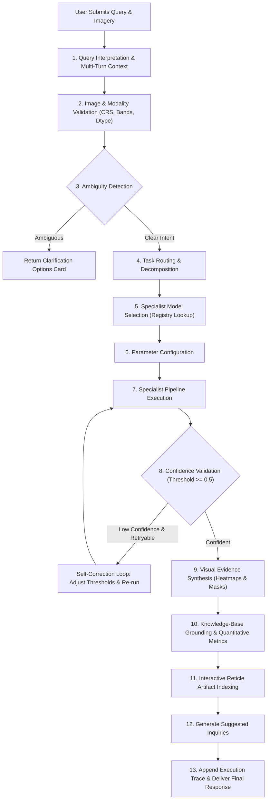

# SatQuery AI — Comprehensive System Documentation

> **Ask Questions. Understand Earth.**  
> *Autonomous Vision-Language Intelligence Platform for Multimodal Remote-Sensing Analysis.*

---

## Table of Contents

1. [Executive Summary & Purpose](#1-executive-summary--purpose)
2. [High-Level Architecture](#2-high-level-architecture)
3. [Agentic Working Mechanism & Execution Lifecycle](#3-agentic-working-mechanism--execution-lifecycle)
4. [Specialist Models & Pipeline Registry](#4-specialist-models--pipeline-registry)
5. [Autonomous Mission Mode](#5-autonomous-mission-mode)
6. [Interactive Region Drill-Down & Grounding](#6-interactive-region-drill-down--grounding)
7. [Frontend Architecture & Geospatial Design System](#7-frontend-architecture--geospatial-design-system)
8. [Backend Services & Data Ingestion](#8-backend-services--data-ingestion)
9. [REST API Specification](#9-rest-api-specification)
10. [Benchmark Evaluation & Verification](#10-benchmark-evaluation--verification)
11. [Deployment & Local Setup Guide](#11-deployment--local-setup-guide)
12. [Repository Directory Structure](#12-repository-directory-structure)

---

## 1. Executive Summary & Purpose

Traditional Earth observation (EO) analysis is hindered by fragmented workflows: optical indices (NDVI, NDWI), Synthetic Aperture Radar (SAR) backscatter analysis, bi-temporal change detection, and spatial feature grounding typically require disparate software suites (e.g., QGIS, SNAP, ENVI) and deep geospatial domain expertise.

**SatQuery AI** unifies these disparate remote-sensing disciplines into a single **agentic vision-language platform**. Users provide satellite or aerial imagery (GeoTIFF, Multispectral TIFF, PNG, JPEG) along with natural language questions or operational objectives. 

The system autonomously:
1. **Parses natural language intent** without requiring users to specify sensor bands or GIS syntax.
2. **Validates sensor metadata**, spatial dimensions, Coordinate Reference Systems (CRS), and radiometric channels.
3. **Selects and orchestrates specialist vision pipelines** (VQA, text-guided grounding, bi-temporal change segmentation, or optical-SAR fusion).
4. **Executes self-correction and parameter retries** when initial confidence scores fall below threshold.
5. **Synthesizes deterministic, evidence-grounded answers** backed by pixel-level heatmaps, bounding box coordinates, quantitative metric deltas (km²), and complete execution traces.
6. **Compiles publication-grade PDF intelligence reports** with full provenance.

---

## 2. High-Level Architecture

SatQuery AI is designed with a decoupled client-server architecture: a high-performance **React 18 / Vite** frontend communicating with an asynchronous **FastAPI / Python 3.10+** backend.

```
┌────────────────────────────────────────────────────────────────────────────────┐
│                       CLIENT TIER (React 18 + Vite)                           │
│  IBM Plex Design System | Tailwind CSS | Recharts | Canvas Overlays            │
└──────────────────────────────────────┬─────────────────────────────────────────┘
                                       │ HTTPS / JSON / Multipart
                                       ▼
┌────────────────────────────────────────────────────────────────────────────────┐
│                     API GATEWAY (FastAPI / Uvicorn)                            │
│  /api/upload | /api/analyze | /api/missions | /api/history | /api/evaluation   │
└──────────────────────────────────────┬─────────────────────────────────────────┘
                                       │
                                       ▼
┌────────────────────────────────────────────────────────────────────────────────┐
│                  AGENTIC ORCHESTRATION ENGINE (Python)                         │
│  Query Interpreter ──► Session Memory ──► Task Classifier ──► Ambiguity Check │
│                                      │                                         │
│                                      ▼                                         │
│                         Specialist Model Registry                              │
│         ┌─────────────────┬─────────────────┬─────────────────┐                │
│         ▼                 ▼                 ▼                 ▼                │
│    VQA Model       Grounding Engine    Change Detection   Optical-SAR Fusion   │
│         │                 │                 │                 │                │
│         └─────────────────┴────────┬────────┴─────────────────┘                │
│                                    ▼                                           │
│                     Self-Correction & Retry Loop                               │
│                                    │                                           │
│                                    ▼                                           │
│                      Evidence Validator & Synthesizer                          │
└──────────────────────────────────────┬─────────────────────────────────────────┘
                                       │
            ┌──────────────────────────┴──────────────────────────┐
            ▼                                                     ▼
┌──────────────────────────┐                        ┌──────────────────────────┐
│   GEOSPATIAL & CV STACK  │                        │   PERSISTENCE LAYER      │
│  OpenCV | NumPy | Pillow │                        │  SQLite (SQLAlchemy)     │
│  Rasterio | GDAL GeoTIFF │                        │  Local File Store        │
│  Scikit-Learn Classifiers│                        │  ReportLab PDF Engine    │
└──────────────────────────┘                        └──────────────────────────┘
```

---

## 3. Agentic Working Mechanism & Execution Lifecycle

When a user submits an inquiry through SatQuery AI, the system runs an auditable, 13-stage deterministic agentic loop implemented in `backend/app/agents/orchestrator.py`:



### Detailed Execution Stages

1. **Query Interpretation & Multi-Turn Context**:
   * Evaluates query semantics and checks active session memory (`session_service.py`).
   * If the user asks a follow-up (e.g., *"What about the southern sector?"* or *"Zoom in on that change"*), context from prior turns is automatically injected into the reasoning state.

2. **Input Validation & Sensor Telemetry**:
   * Inspects image dimensionality, data type (uint8, uint16, float32), channel count, Coordinate Reference System (CRS), and spatial bounding coordinates via `geo_io.py`.
   * Identifies sensor modality: Single Optical MSI, Bi-Temporal Optical Pair, or Optical + SAR (Synthetic Aperture Radar) pair.

3. **Ambiguity Detection & Clarification**:
   * If the input is genuinely vague (e.g., *"check this"* or *"what is here"* without specific context), the agent returns an interactive **Clarification Card** providing domain-specific choices (e.g., *Check for flood inundation*, *Identify urban growth*, *Calculate vegetation loss*).

4. **Task Classification & Model Selection**:
   * Routes the query to one of seven specialized capabilities:
     * `vqa`: Single-image Visual Question Answering.
     * `captioning`: Comprehensive scene description and land-cover summarization.
     * `grounding`: Pixel-level segmentation and bounding box extraction for referenced objects.
     * `change_detection`: Pixel- and parcel-level bi-temporal surface change detection.
     * `change_vqa`: Question answering over temporal surface variations.
     * `optical_sar_fusion`: Cross-modal feature extraction combining optical MSI and microwave radar.
     * `general_analysis`: Geospatial coordinate and spectral band profiling.

5. **Self-Correction & Autonomous Retry Loop**:
   * For tasks where segmentation thresholds are dynamic (`grounding`, `change_detection`, `change_vqa`), if the calculated confidence falls below `0.5`, the agent logs a `RetryAttempt`, recalibrates morphological kernel sizes and variance thresholds, and re-executes inference.

6. **Evidence Synthesis & Grounding**:
   * Creates colorized differential heatmaps (Jet/Inferno colormaps), binary mask overlays, or bounding reticles.
   * Generates quantitative metric summaries (e.g., changed area in km², percent surface shift, spectral reflectance shifts).

7. **Artifact Indexing & Session Trace**:
   * Caches spatial regions in memory (`ANALYSIS_ARTIFACTS`) to enable instant point-and-click localized analysis without re-running the complete pipeline.
   * Compiles an auditable `TraceStep` log capturing tool names, execution latency (ms), input parameters, and intermediate outputs.

---

## 4. Specialist Models & Pipeline Registry

All inference pipelines are decoupled and registered in `backend/app/models/registry.py` under the `MODEL_REGISTRY`. The agent queries this registry dynamically rather than relying on hardcoded procedural scripts.

| Model Identifier | Primary Task | Input Modality | Output Artifacts | Underlying Architecture & Implementation |
| :--- | :--- | :--- | :--- | :--- |
| **`RemoteSensingVQAModel`** | `vqa` | Single Optical / SAR / MSI | Text Answer, Confidence Score, Evidence Regions | Trained Random Forest land-cover classifier (`synthetic_landcover_classifier.joblib`) over color/texture/spectral histograms; deterministic heuristic fallback for fine-grained inquiries. |
| **`RemoteSensingCaptionModel`** | `captioning` | Single Optical / MSI | Comprehensive Scene Caption, Land-Cover Breakdown | Deterministic land-cover proportion estimator, spatial distribution analyzer, and natural language synthesis engine. |
| **`GroundingModel`** | `grounding` | Single Optical / MSI | Binary Segmentation Mask, Bounding Boxes | Spectral index thresholding (NDWI/NDVI proxies), HSV/spectral clustering, and connected-component contour extraction. |
| **`ChangeDetectionModel`** | `change_detection` | Bi-Temporal Pair (T1 + T2) | Differential Heatmap, Contiguous Change Masks, Divergence Score | Absolute radiometric differencing, multi-scale morphological filtering, Otsu dynamic thresholding, and contour parcel extraction. |
| **`ChangeVQAModel`** | `change_vqa` | Bi-Temporal Pair (T1 + T2) | Categorical/Quantitative Answer, Confidence | Differential area statistics, class-specific transition matrices (vegetation $\to$ bare soil, bare soil $\to$ built-up), and directionality classification. |
| **`OpticalSARFusionModel`** | `optical_sar_fusion` | Cross-Modal Pair (Optical + SAR) | Fused Composite Map, Built-up & Water Masks | Optical reflectance normalization paired with log-scaled C-band radar backscatter ($\sigma^\circ$). Exploits radar double-bounce (urban) and specular reflection (water). |
| **`GeospatialAnalysisTools`** | `general_analysis` | Any Remote Sensing File | Metadata, CRS, Bounds, Band Stats | Rasterio and GDAL-backed deterministic driver extracting geo-transforms, projection definitions, and radiometric channel statistics. |

### Checkpoint Drop-In Readiness

The platform is designed for zero-code checkpoint upgrades:
* Standard deep learning weights (`.pt`, `.onnx`, `.joblib`) staged in `models/checkpoints/` are automatically detected by `_detect_vqa_classifier_status()`.
* If a PyTorch checkpoint (e.g., `rs_vqa.pt`, `change_det.pt`, or a BigEarthNet-adapted model) is detected, the registry promotes the pipeline from `fallback-heuristic` to `finetuned-checkpoint` without breaking API contracts.

---

## 5. Autonomous Mission Mode

While standard analysis handles single questions, **Mission Mode** (`/missions`) allows non-technical operators to specify high-level operational directives (e.g., *"Investigate whether flooding has affected agricultural land"*).

The **Mission Planner Agent** (`backend/app/agents/mission_planner.py`) decomposes this single directive into a structured Directed Acyclic Graph (DAG) consisting of 9 sequential tasks:


### Supported Investigation Domains

1. **Flood Impact & Agricultural Vulnerability**:
   * Evaluates pre-event crop canopy versus post-event water inundation.
   * Cross-validates specular radar backscatter (SAR) to identify floodwater beneath vegetation.
   * Delineates affected farm parcels and computes damaged cropland area in square kilometers ($km^2$).

2. **Urban Expansion & Infrastructure Sprawl**:
   * Tracks vegetation and agricultural conversion into impervious built-up surfaces.
   * Delineates contiguous new construction corridors, roads, and industrial facilities.

3. **Forest Canopy & Biomass Loss**:
   * Computes canopy clearance, deforestation boundaries, and bare soil exposure.
   * Correlates optical leaf-reflectance degradation with radar volumetric scattering decreases.

4. **Water Body Dynamics & Reservoir Depletion**:
   * Analyzes multi-date reservoir perimeters and surface water shrinkage.
   * Distinguishes seasonal moisture variation from severe permanent hydrologic recession.

---

## 6. Interactive Region Drill-Down & Grounding

SatQuery AI introduces a spatial interaction pattern: **Click-to-Explain (Reticle Follow-up)**.

1. When a change overlay or spatial grounding map is rendered in the UI, every detected anomaly is indexed with its bounding coordinates in pixel space.
2. The user clicks any specific point or parcel directly on the imagery preview.
3. The frontend captures the normalized coordinate fraction $(X_{frac}, Y_{frac})$, maps it to the image's native resolution, and dispatches an asynchronous call to `/api/analyze/region-followup`.
4. The backend identifies the intersecting parcel in `ANALYSIS_ARTIFACTS` and immediately returns localized statistics (area, classification, spectral shift) without executing the full end-to-end pipeline again.

---

## 7. Frontend Architecture & Geospatial Design System

The frontend application (`satquery-ai/frontend`) is built with React 18, TypeScript, Vite, and Tailwind CSS. It follows a restrained **Enterprise Geospatial Visual Identity** designed for high information density, clarity, and operational credibility.

### Typography System
* **Primary Family:** `IBM Plex Sans` (Headings `600`, Section Titles `500–600`, Body `400`, Navigation/Controls `500`).
* **Secondary Family:** `IBM Plex Mono` (All satellite identifiers, sensor bands, orbital ephemeris, coordinates, timestamps, and metric readouts with tabular numerals).

### Strict Enterprise Color Palette

| Token Name | Hex Code | Primary Operational Usage |
| :--- | :--- | :--- |
| **Main Background** | `#0B1118` | Global viewport canvas; deep neutral dark slate. |
| **Secondary Background** | `#101923` | Top navigation bar, nested containers, input boxes. |
| **Primary Card Surface** | `#141F2A` | Standard panels, analysis cards, visual containers. |
| **Elevated Surface** | `#192633` | Hover states, active buttons, raised modal dialogs. |
| **Border Neutral** | `#273543` | 1px clean container and section dividing borders. |
| **Border Light** | `#36485C` | Active border highlights and subtle card hover states. |
| **Primary Text** | `#E5EAF0` | High-contrast body text and card titles. |
| **Secondary Text** | `#9AA8B7` | Subheadings, descriptive captions, and metadata labels. |
| **Muted Text** | `#718096` | De-emphasized timestamps, inactive tabs, disabled states. |
| **Satellite Teal (Primary Accent)** | `#48A9A6` | Active navigation indicators, primary CTA buttons, sliders. |
| **Desaturated Blue (Secondary Accent)** | `#648DB5` | Secondary metrics, baseline data series, SAR indicators. |
| **Success Tone** | `#6BA88B` | Completed traces, positive vegetation shifts, verified flags. |
| **Warning Tone** | `#D3A35C` | Clarification prompts, low-confidence retries, synthetic flags. |
| **Error Tone** | `#CF7777` | Upload errors, missing CRS, negative vegetation deltas. |

### Application Pages & Routes

* `/dashboard`: Executive monitoring hub displaying platform ingestion metrics, operational latency, and recent analyses.
* `/analyze`: Interactive investigation workbench supporting Single-Image VQA, Bi-Temporal Change Detection, and Optical-SAR Fusion.
* `/missions`: Autonomous investigation studio with parcel delineation and downloadable mission reports.
* `/history`: Audit trail archive with step-by-step pipeline execution traces.
* `/models`: Specialist model registry detailing parameter requirements, tasks, and checkpoint statuses.
* `/evaluation`: Benchmark validation suite running live tests on VRSBench, RSVQA, and CDVQA datasets.
* `/settings`: Local runtime configuration, compute mode toggle (CPU/GPU), and storage path readouts.

---

## 8. Backend Services & Data Ingestion

The backend architecture is structured into specialized services (`satquery-ai/backend/app/services`):

* `upload_service.py`: Ingests satellite files, validates file headers, generates web-safe RGB thumbnails for GeoTIFFs, extracts CRS/bounds via Rasterio, and caches records in SQLite.
* `history_service.py`: Persists every query, answer, confidence score, execution trace, and visual artifact to SQLite with SHA-256 integrity tagging.
* `mission_service.py`: Orchestrates multi-step investigation DAGs, parcel impact delineation, and metric calculations.
* `session_service.py`: Maintains session-level conversation memory for multi-turn contextual queries.
* `knowledge_base.py`: Provides deterministic domain facts on sensors (Sentinel-1, Sentinel-2, Landsat-8/9, WorldView-3), spectral bands, and radiometric resolutions.
* `report_service.py`: Uses ReportLab to generate publication-grade PDF reports including imagery side-by-sides, findings, and execution trace tables.

---

## 9. REST API Specification

### Core Endpoints

#### Ingestion & Analysis
* **`POST /api/upload`**: Uploads satellite image. Returns metadata (dimensions, bands, CRS, modality guess, thumbnail preview URL).
* **`POST /api/analyze`**: Main agentic dispatch. Accepts `query`, `mode` (`single`, `before_after`, `optical_sar`), `image_ids`, and optional `session_id`. Returns full `AnalyzeResponse`.
* **`POST /api/analyze/region-followup`**: Interactive reticle click. Accepts `analysis_id`, pixel `x`, and pixel `y`. Returns localized parcel explanation.
* **`GET /api/files/{filename}`**: Serves uploaded images, generated masks, and differential heatmaps.

#### Autonomous Missions
* **`POST /api/missions/plan`**: Generates a 9-step investigation DAG from a natural-language objective.
* **`POST /api/missions/run`**: Executes the autonomous multi-step mission across baseline and observation imagery.
* **`GET /api/missions`**: Lists all archived autonomous investigations.
* **`GET /api/missions/{mission_id}`**: Retrieves complete mission results, affected parcels, and statistics.
* **`POST /api/missions/{mission_id}/report`**: Generates and downloads a publication-ready PDF mission report.

#### History & Auditability
* **`GET /api/history`**: Lists past analysis records.
* **`GET /api/history/{analysis_id}`**: Retrieves a specific analysis with visual outputs and execution trace.
* **`POST /api/history/summarize`**: Generates a synthesis across recent analyses.
* **`POST /api/reports/{analysis_id}`**: Generates and downloads a PDF analysis report.

#### Model Registry & Evaluation
* **`GET /api/models`**: Returns all registered specialist models, tasks, and checkpoint statuses.
* **`POST /api/evaluation/run`**: Executes an evaluation run against benchmark datasets (`vrsbench`, `rsvqa`, `cdvqa`, `custom`).
* **`GET /api/evaluation/datasets`**: Checks availability of local benchmark test suites.

---

## 10. Benchmark Evaluation & Verification

SatQuery AI includes a rigorous benchmarking harness (`backend/app/evaluation/eval_runner.py`) designed to validate the vision-language pipelines against standardized Earth observation datasets:

* **VRSBench**: Evaluates visual question answering, captioning, and spatial grounding.
* **RSVQA**: Standard single-image remote sensing VQA dataset.
* **CDVQA**: Bi-temporal change detection and multi-temporal question answering.

> [!NOTE]
> **Integrity Guarantee**: When benchmark files are absent, evaluation runs are explicitly labeled as **`SYNTHETIC RESULTS`** (computed over synthetic labeled scenes). The system never generates fabricated scores.

---

## 11. Deployment & Local Setup Guide

### Local Development Setup

#### 1. Backend (FastAPI)
```powershell
# Navigate to backend directory
cd satquery-ai/backend

# Create and activate virtual environment
python -m venv venv
.\venv\Scripts\Activate.ps1   # On Windows (or 'source venv/bin/activate' on Linux/macOS)

# Install backend dependencies
pip install -r requirements.txt

# Start FastAPI development server
uvicorn app.main:app --host 127.0.0.1 --port 8000 --reload
```
The backend API documentation is interactively accessible at `http://127.0.0.1:8000/docs`.

#### 2. Frontend (React + Vite)
```powershell
# Navigate to frontend directory
cd satquery-ai/frontend

# Install dependencies
npm install

# Start Vite development server
npm run dev
```
The frontend is available at `http://localhost:5173`.

---

### Production Deployment

#### Vercel Deployment (Frontend)
The frontend is configured for deployment on **Vercel**:
1. **Root Directory**: `satquery-ai/frontend`
2. **Build Command**: `npm run build`
3. **Output Directory**: `dist`
4. **Environment Variables**:
   * `VITE_API_BASE_URL`: URL of your deployed FastAPI backend (e.g., `https://api.satquery.ai`).
5. **SPA Rewrites**: Pre-configured in `satquery-ai/frontend/vercel.json` to handle client-side routing on page refreshes.

#### Backend Production Deployment
Deploy the FastAPI application on any cloud host (Railway, AWS EC2, GCP Cloud Run, or Docker):
```dockerfile
FROM python:3.10-slim

WORKDIR /app
COPY requirements.txt .
RUN pip install --no-cache-dir -r requirements.txt

COPY . .
EXPOSE 8000

CMD ["uvicorn", "app.main:app", "--host", "0.0.0.0", "--port", "8000"]
```

---

## 12. Repository Directory Structure

```
satquery-ai-final/
├── package.json                         # Root orchestration scripts
├── PROJECT_DOCUMENTATION.md             # Complete system documentation
└── satquery-ai/
    ├── README.md                        # Project landing readme
    ├── backend/                         # FastAPI backend service
    │   ├── requirements.txt             # Python dependencies
    │   ├── app/
    │   │   ├── main.py                  # Application entry point & CORS configuration
    │   │   ├── core_config.py           # Paths, upload directories, environment variables
    │   │   ├── agents/                  # Agentic intelligence modules
    │   │   │   ├── orchestrator.py      # Primary 13-stage agentic orchestrator
    │   │   │   ├── confidence_and_router.py # Task classification & scoring
    │   │   │   ├── mission_planner.py   # Autonomous mission DAG planner
    │   │   │   └── followups.py         # Dynamic query suggestion generator
    │   │   ├── api/
    │   │   │   └── routes.py            # REST API route handlers
    │   │   ├── models/
    │   │   │   └── registry.py          # Specialist model registry & checkpoint detection
    │   │   ├── services/                # Business logic & persistence
    │   │   │   ├── upload_service.py    # Image ingestion & GeoTIFF preprocessing
    │   │   │   ├── history_service.py   # SQLite trace persistence & summarizer
    │   │   │   ├── mission_service.py   # Multi-phase investigation runner
    │   │   │   ├── session_service.py   # Multi-turn conversational memory
    │   │   │   ├── knowledge_base.py    # Deterministic EO domain facts
    │   │   │   └── report_service.py    # ReportLab PDF synthesis engine
    │   │   ├── tools/                   # Computer vision & geospatial drivers
    │   │   │   ├── geo_io.py            # Rasterio/GDAL geospatial file reader
    │   │   │   ├── vision_tools.py      # VQA, captioning, and grounding primitives
    │   │   │   ├── change_and_fusion.py # Bi-temporal change & Optical+SAR fusion
    │   │   │   └── spectral_analysis.py # Vegetation/biophysical metric calculations
    │   │   ├── evaluation/              # Benchmark evaluation runners
    │   │   │   └── eval_runner.py       # VRSBench, RSVQA, and CDVQA test harnesses
    │   │   └── schemas/                 # Pydantic v2 data models
    │   │       ├── schemas.py           # Core request/response schemas
    │   │       └── mission_schemas.py   # Mission DAG and parcel schemas
    │   ├── data/                        # Static datasets & demo presets
    │   ├── uploads/                     # Local storage for uploaded imagery & artifacts
    │   └── reports_out/                 # Generated PDF analysis & mission reports
    └── frontend/                        # React 18 + Vite frontend
        ├── package.json                 # Node dependencies
        ├── vite.config.ts               # Vite configuration with API proxying
        ├── tailwind.config.js           # Geospatial color tokens & typography mapping
        ├── vercel.json                  # Vercel deployment & SPA rewrite routing
        ├── index.html                   # HTML template loading IBM Plex fonts
        └── src/
            ├── index.css                # Base styling & utility classes
            ├── types/                   # TypeScript interface definitions
            ├── services/                # Axios API client bindings
            ├── layouts/
            │   └── AppLayout.tsx        # Enterprise header, nav, and status footer
            ├── components/
            │   ├── ui/primitives.tsx    # Standardized Cards, Badges, Buttons
            │   ├── UploadZone.tsx       # Drag-and-drop imagery uploader
            │   ├── ResultsPanel.tsx     # Temporal slider, answer card, visual evidence
            │   ├── AgentExecutingPanel.tsx # Execution spinner & progress steps
            │   ├── ClarificationCard.tsx# Interactive query clarification prompt
            │   ├── ClickableRegionImage.tsx # Click-to-explain reticle interaction
            │   ├── AdvancedSpectralBiophysicalAnalysis.tsx # Recharts radar & bar charts
            │   └── space/               # Interactive satellite telemetry & orbital models
            └── pages/
                ├── LandingPage.tsx      # Public landing page & platform capabilities
                ├── DashboardPage.tsx    # Telemetry overview & recent analyses
                ├── AnalyzePage.tsx      # Single/pair/fusion inquiry workbench
                ├── MissionPage.tsx      # Autonomous multi-step investigation studio
                ├── HistoryPage.tsx      # Auditable trace archive
                ├── ModelsPage.tsx       # Specialist pipeline registry
                ├── EvaluationPage.tsx   # Benchmark validation suite
                └── SettingsPage.tsx     # System runtime parameters
```
